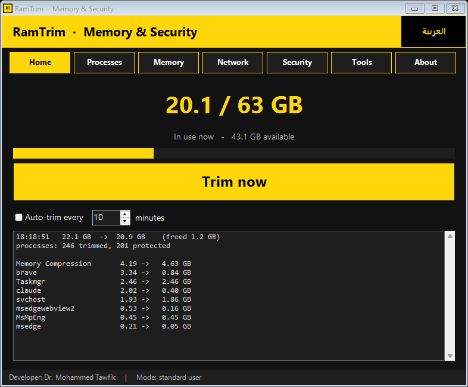
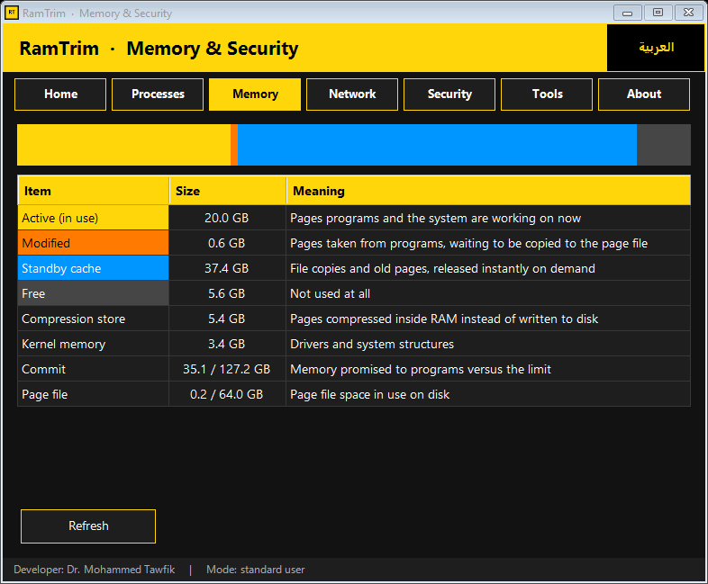
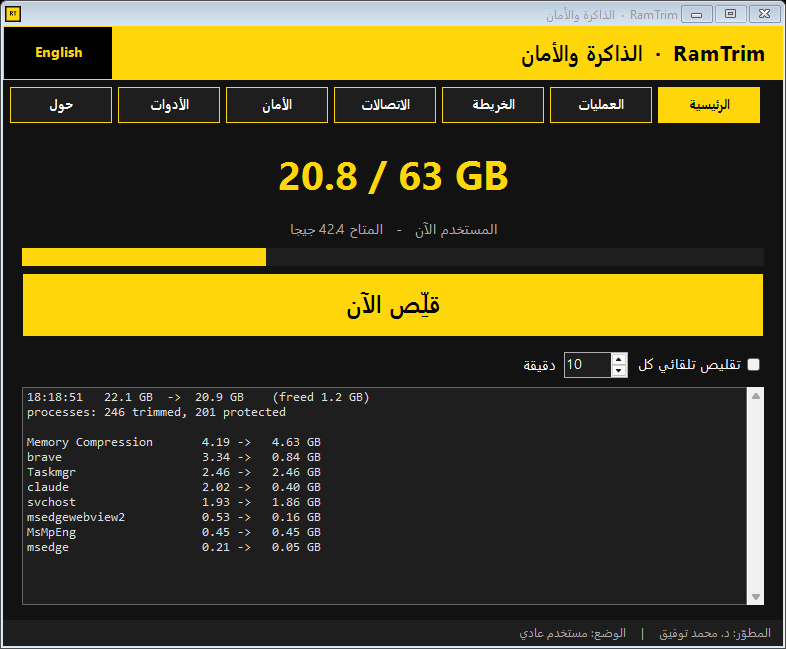

# RamTrim

Memory trimmer and security monitor for Windows 10/11. One portable EXE, Arabic and English interface, nothing to install and nothing sent off the machine.

**Download:** [RamTrim.exe from the latest release](https://github.com/kmkholm/RamTrim/releases/latest)



## What it does

**Memory**

- **Trim now.** Asks every process to give back the pages it is not using (`EmptyWorkingSet`). The pages move to the standby cache and become available to other programs; whatever a program really needs returns on first use.
- **Auto-trim** every N minutes.
- **Processes.** Top programs by RAM, trim or end a selected one.
- **Memory map.** Active, modified, standby cache, free, compression store, kernel pools, commit and page file, each explained in one line.
- **Tools.** Restart as administrator, flush the standby cache, deep clean, save a report, open Task Manager and Resource Monitor.

**Security**

- **Network page.** Every TCP/UDP endpoint with its owning program, remote address, host name (from the local DNS cache), scope and signature status.
- **Security scan.** Each finding states the evidence it rests on:
  - connections owned by a PID that has no visible process (re-checked to rule out a process that was exiting);
  - Windows core processes running from the wrong folder or started by the wrong parent, and names one character away from a core process;
  - executables modified after signing, unsigned, or signed by an untrusted certificate, with more weight when they run from a temp folder or hold internet connections;
  - script hosts with download or encoded command lines, or with internet connections;
  - remote-control software that is running;
  - which apps are using the microphone or camera now, and which used them in the last 7 days;
  - Run keys, Startup folder and scheduled tasks;
  - hosts file redirects, proxy settings, Defender real-time protection and firewall state.



## Limits

- Findings are indicators to review, not proof of malware.
- Without administrator rights Windows hides the file path of protected system processes. The scan reports how many it could not verify instead of guessing.
- It does not detect kernel rootkits or keyboard hooks.
- Trimming does not make the PC faster. It frees RAM before a heavy job; pages a program touches again come back.
- The EXE is not code-signed, so SmartScreen may warn on first run.

## Run from source

```
RamTrim.cmd
```

Command-line modes of `src\RamTrim.ps1`:

| Switch | Effect |
|---|---|
| `-Cli` | One trim, numbers printed |
| `-Scan` | Security scan, report printed |
| `-Snap <dir>` | Self-test: walks every page in both languages and saves a PNG of each |

## Build

```
build.cmd
```

Uses the C# compiler that ships with Windows (`csc.exe`, .NET Framework 4) and downloads nothing. The build merges `src\RamTrim.ps1` and `src\Security.ps1`, embeds the result in `src\Launcher.cs`, and writes `RamTrim.exe`. The launcher hosts PowerShell in-process, so no console window appears.

## Layout

| Path | Content |
|---|---|
| `src/RamTrim.ps1` | Interface and memory engine |
| `src/Security.ps1` | Connections and security scan engine |
| `src/Launcher.cs` | Single-file EXE host |
| `tools/build.ps1` | Build script |
| `tools/make_icon.ps1` | Draws `assets/RamTrim.ico` |

---

<div dir="rtl">

## بالعربية

RamTrim أداة لويندوز 10/11 تجمع تقليص الذاكرة والفحص الأمني في ملف EXE واحد، بواجهة عربية وإنجليزية، بلا تثبيت ولا إرسال أي بيانات خارج الجهاز.

**الذاكرة:** زر «قلِّص الآن» يجعل كل برنامج يتخلى عن الصفحات التي لا يستعملها، مع تقليص تلقائي، وجدول للعمليات، وخريطة تشرح أين تذهب الرام.

**الأمان:** تبويب «الاتصالات» يعرض كل اتصال مع برنامجه وعنوانه واسم الموقع وحالة التوقيع. تبويب «الأمان» يفحص الاتصالات التي لا تملكها عملية ظاهرة، وعمليات النظام المنتحلة، والملفات غير الموقَّعة أو المعدَّلة، وبرامج التحكم عن بعد، ومن يستخدم الميكروفون والكاميرا، وما يبدأ مع ويندوز، وملف hosts والوسيط و Defender والجدار الناري.

**الحدود:** النتائج مؤشرات للمراجعة وليست حكمًا. الأداة لا تكشف الجذور الخفية داخل النواة ولا راصدات لوحة المفاتيح، والتقليص لا يسرّع الجهاز بل يفرّغ مساحة قبل مهمة ثقيلة.



</div>

## Developer

Dr. Mohammed Tawfik, Department of Cyber Security, Faculty of Information Technology, Ajloun National University.
ORCID [0000-0002-1227-387X](https://orcid.org/0000-0002-1227-387X)

## License

MIT
